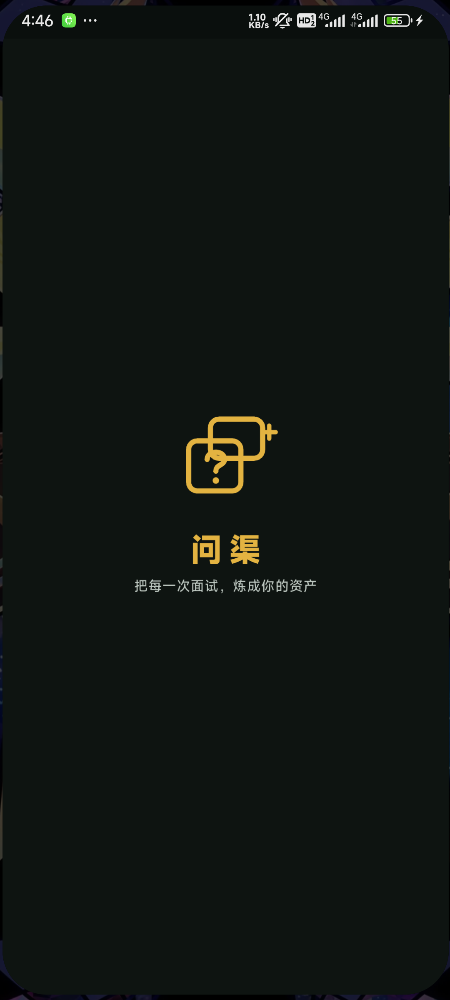
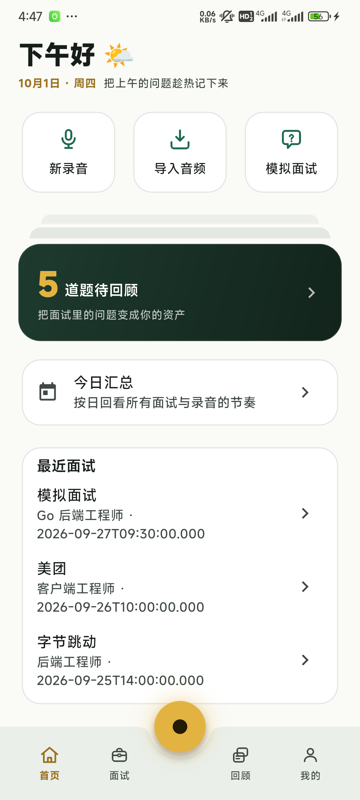

<p align="center">
  
</p>

# 问渠 InterviewVault

> 把每一次面试，炼成你的资产。

**问渠 InterviewVault** 是一个本地优先的个人面试知识库 App：以面试录音 / 模拟面试为输入，以问题卡片和复盘总结为输出。导入真实面试录音或进行 AI 模拟面试，App 完成转写、标注、卡片生成与总结导出——AI 能力由你自己的 API Key 驱动，数据全程留在本地。

它不是"AI 面试工具"，而是面试场景下的知识管理工具：核心价值不是"帮你面试"，而是"帮你把每一次面试变成可复用的资产"。

<p align="center">
  
  
</p>

## ✨ 核心特性

- 🎙️ **录音与导入** — 锁屏后台录音（前台服务 + 常驻通知）、暂停/继续、实时波形；支持从本机音频库点选、录音机分享直达、文件管理器三种方式导入 mp3 / wav / m4a / aac / ogg，导入前可逐条试听
- 📝 **转写与标注** — 本地 whisper.cpp（dart:ffi + Isolate，UI 永不阻塞）或用户自配云端 ASR；带时间戳逐字稿可编辑校正，支持 问题 / 回答 / 亮点 / 失误 / 待改进 标签标注，点击标注播放器跳转到对应位置
- 🃏 **问题卡片与回顾** — 面试里被问倒的问题沉淀成卡片，首页提示"N 道题待回顾"，翻卡模式开始回顾
- 🤖 **模拟面试（BYOK）** — 支持 OpenAI / DeepSeek / Kimi / 通义千问 / Claude 及任意 OpenAI 兼容接口；Key 只存 Android Keystore，请求从客户端直连你配置的端点，App 不经过任何中间服务器
- 📤 **数据自主** — 全量 JSON + Markdown 随时导出带走，删除即真删；无账号、无后端、无遥测

## 🧭 设计铁律

1. **本地优先** — 录音、转写稿、标注、卡片全存本地（SQLite + 文件系统），离线可用
2. **用户自持 AI** — 不内置 AI、不送额度；App 只是遥控器
3. **数据自主** — 全量导出，随时带走

## 🛠️ 技术栈

| 层 | 选型 |
|---|---|
| 框架 | Flutter 3 + Dart 3（Material 3，暗色优先） |
| 状态 / 路由 | Riverpod · go_router |
| 数据库 | drift（SQLite，类型安全 + 响应式 watch + 迁移测试） |
| 安全存储 | flutter_secure_storage（Android Keystore） |
| 录音 / 播放 | record（振幅流波形）· just_audio + audio_session |
| 本地转写 | whisper.cpp（ffigen 绑定，Isolate 执行） |
| 音频解码 | FFmpegKit 社区维护 fork（任意格式 → 16kHz 单声道 PCM） |
| 网络 | dio + SSE 流式（Key 仅注入用户配置的 baseUrl） |
| 模型 / 导出 | freezed + json_serializable · Markdown / JSON 导出 |

## 📥 下载

前往 [**Releases**](https://github.com/MaoXinze/InterviewVault/releases) 下载最新 APK（当前仅支持 Android，iOS 延后）。

## 🔨 从源码构建

```bash
git clone https://github.com/MaoXinze/InterviewVault.git
cd InterviewVault/interview_vault
flutter pub get

# 代码生成（*.g.dart / *.freezed.dart 不入库，clone 后必须先跑）
dart run build_runner build --delete-conflicting-outputs

flutter run
```

测试与静态检查：

```bash
flutter analyze   # 0 issue
flutter test      # 258 个测试全绿
```

## 📚 文档

- [PRD.md](docs/PRD.md) — 产品需求 + 技术实现规格（含表结构与执行修订）
- [PLAN.md](docs/PLAN.md) — 技术栈定稿、项目结构、路线图
- [业务流程.md](docs/业务流程.md) — 核心链路业务流程

## 📄 许可证

暂未设置开源许可证，保留所有权利。如需引用代码请先开 issue 联系。
